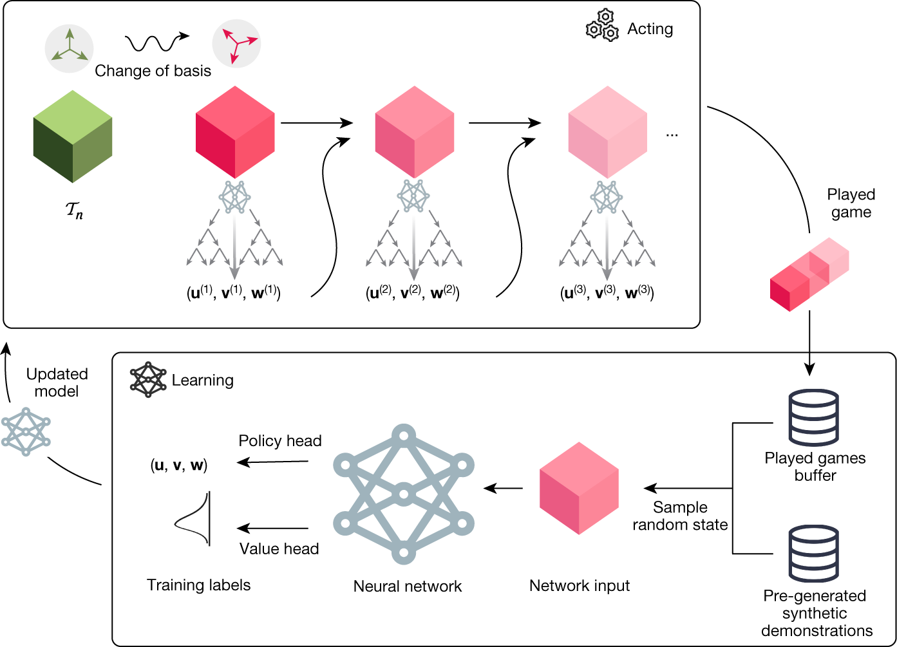
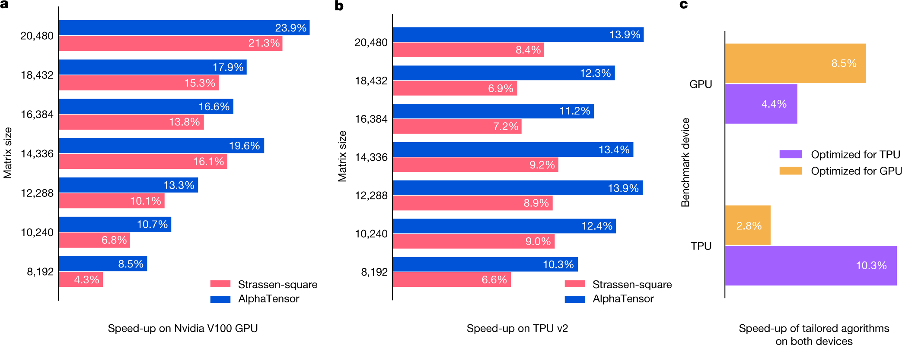

# Discovering faster matrix multiplication algorithms with reinforcement learning

Nature · 2022 · 方法借鉴

[论文原文](https://www.nature.com/articles/s41586-022-05172-4) · [DOI](https://doi.org/10.1038/s41586-022-05172-4)

借鉴复杂优化问题转成序贯决策，以及搜索、经验与学习器的组织方式。

许可：CC BY 4.0。分区详见 [筛选依据](../docs/selection.md)，未宣称已核验中科院一区。

## Fig. 2 搜索器与学习器的协同

**用途：** 世界模型。

**画法借鉴：** 区分策略网络、搜索器、actor、经验数据和示范数据的流向。

**解释边界：** 搜索器不是环境转移模型；不要把两者合并。

[原始图页](https://www.nature.com/articles/s41586-022-05172-4/figures/2)

Fawzi, Alhussein; Balog, Matej; Huang, Aja; Hubert, Thomas; Romera-Paredes, Bernardino; Barekatain, Mohammadamin; Novikov, Alexander; R. Ruiz, Francisco J.; Schrittwieser, Julian; Swirszcz, Grzegorz; Silver, David; Hassabis, Demis; Kohli, Pushmeet. Discovering faster matrix multiplication algorithms with reinforcement learning. Nature (2022), Fig. 2. https://doi.org/10.1038/s41586-022-05172-4. CC BY 4.0. 未裁切、未重绘；按比例显示。

## Fig. 5 优化目标之外的实际收益

**用途：** 性能比较。

**画法借鉴：** 同时展示不同规模和平台的真实运行收益，让代理目标与实际指标分离。

**解释边界：** 运算次数更少并不保证所有硬件上更快。

[原始图页](https://www.nature.com/articles/s41586-022-05172-4/figures/5)

Fawzi, Alhussein; Balog, Matej; Huang, Aja; Hubert, Thomas; Romera-Paredes, Bernardino; Barekatain, Mohammadamin; Novikov, Alexander; R. Ruiz, Francisco J.; Schrittwieser, Julian; Swirszcz, Grzegorz; Silver, David; Hassabis, Demis; Kohli, Pushmeet. Discovering faster matrix multiplication algorithms with reinforcement learning. Nature (2022), Fig. 5. https://doi.org/10.1038/s41586-022-05172-4. CC BY 4.0. 未裁切、未重绘；按比例显示。
