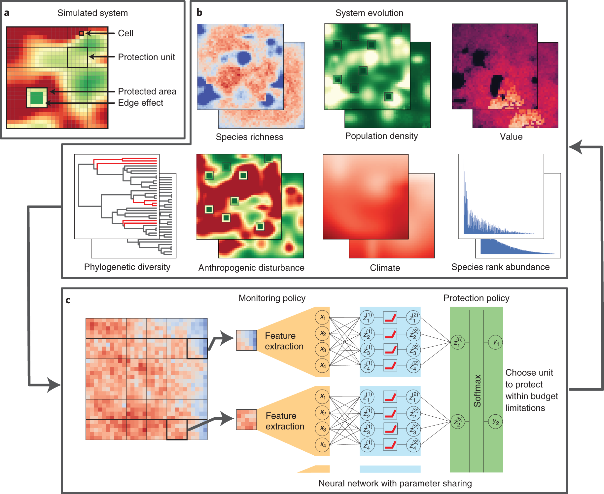
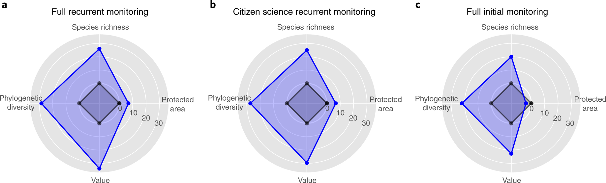
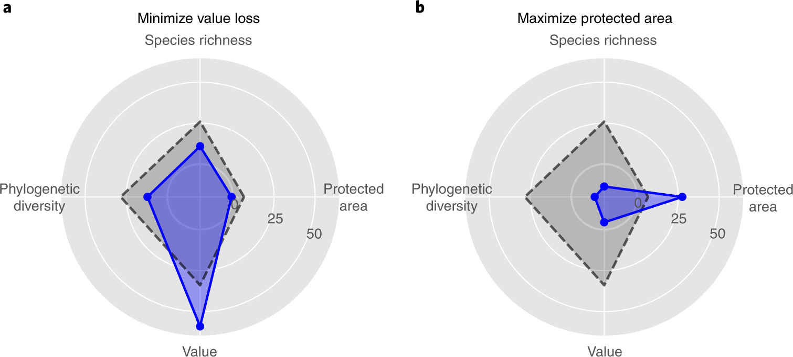
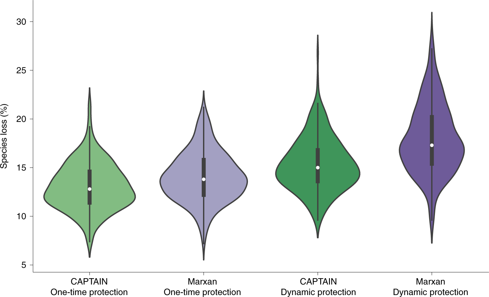
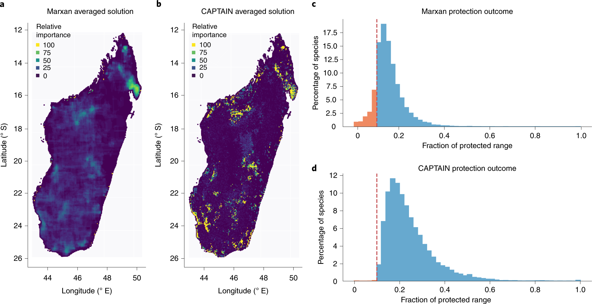

# Improving biodiversity protection through artificial intelligence

Nature Sustainability · 2022 · 优先阅读

[论文原文](https://www.nature.com/articles/s41893-022-00851-6) · [DOI](https://doi.org/10.1038/s41893-022-00851-6)

把生态过程、监测信息、预算和保护动作连成闭环；适合地球系统科学总框架。

许可：CC BY 4.0。分区详见 [筛选依据](../docs/selection.md)，未宣称已核验中科院一区。

## Fig. 1 生态过程怎样成为决策环境

**用途：** MDP 框架。

**画法借鉴：** 先画生态状态和人类扰动，再画观测、预算与保护行动；将动态模拟器与策略网络分层。

**解释边界：** 观测到的物种信息不等于完整生态状态。

[原始图页](https://www.nature.com/articles/s41893-022-00851-6/figures/1)

Silvestro, Daniele; Goria, Stefano; Sterner, Thomas; Antonelli, Alexandre. Improving biodiversity protection through artificial intelligence. Nature Sustainability (2022), Fig. 1. https://doi.org/10.1038/s41893-022-00851-6. CC BY 4.0. 未裁切、未重绘；按比例显示。

## Fig. 2 监测信息改变保护成效

**用途：** 观测与信息。

**画法借鉴：** 并排比较监测频率和观测精度，让信息条件成为实验变量。

**解释边界：** 面积、物种和价值不是同一指标，不能只看雷达图面积。

[原始图页](https://www.nature.com/articles/s41893-022-00851-6/figures/2)

Silvestro, Daniele; Goria, Stefano; Sterner, Thomas; Antonelli, Alexandre. Improving biodiversity protection through artificial intelligence. Nature Sustainability (2022), Fig. 2. https://doi.org/10.1038/s41893-022-00851-6. CC BY 4.0. 未裁切、未重绘；按比例显示。

## Fig. 3 政策目标与生态结果的权衡

**用途：** 多目标权衡。

**画法借鉴：** 固定环境与预算，只改变优化目标，展示各生态指标随之变化。

**解释边界：** 多个目标设置的对比不自动构成完整 Pareto 前沿。

[原始图页](https://www.nature.com/articles/s41893-022-00851-6/figures/3)

Silvestro, Daniele; Goria, Stefano; Sterner, Thomas; Antonelli, Alexandre. Improving biodiversity protection through artificial intelligence. Nature Sustainability (2022), Fig. 3. https://doi.org/10.1038/s41893-022-00851-6. CC BY 4.0. 未裁切、未重绘；按比例显示。

## Fig. 5 重复模拟的分布式比较

**用途：** 性能比较。

**画法借鉴：** 用小提琴图保留不同模拟中的离散程度，同时标出中位数和四分位。

**解释边界：** 模拟重复、随机种子和独立研究区的统计含义不同。

[原始图页](https://www.nature.com/articles/s41893-022-00851-6/figures/5)

Silvestro, Daniele; Goria, Stefano; Sterner, Thomas; Antonelli, Alexandre. Improving biodiversity protection through artificial intelligence. Nature Sustainability (2022), Fig. 5. https://doi.org/10.1038/s41893-022-00851-6. CC BY 4.0. 未裁切、未重绘；按比例显示。

## Fig. 6 空间优先级与保护覆盖

**用途：** 空间决策。

**画法借鉴：** 同一地图范围展示候选方法，再接物种覆盖分布；从空间模式走向结果。

**解释边界：** 优先级是入选频率，不是保护带来的因果收益。

[原始图页](https://www.nature.com/articles/s41893-022-00851-6/figures/6)

Silvestro, Daniele; Goria, Stefano; Sterner, Thomas; Antonelli, Alexandre. Improving biodiversity protection through artificial intelligence. Nature Sustainability (2022), Fig. 6. https://doi.org/10.1038/s41893-022-00851-6. CC BY 4.0. 未裁切、未重绘；按比例显示。
