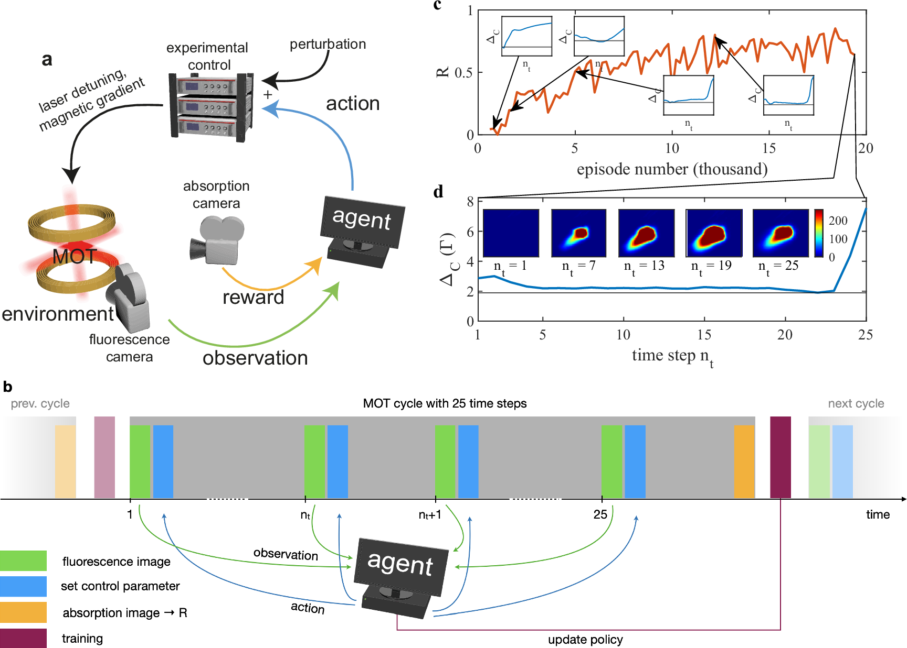
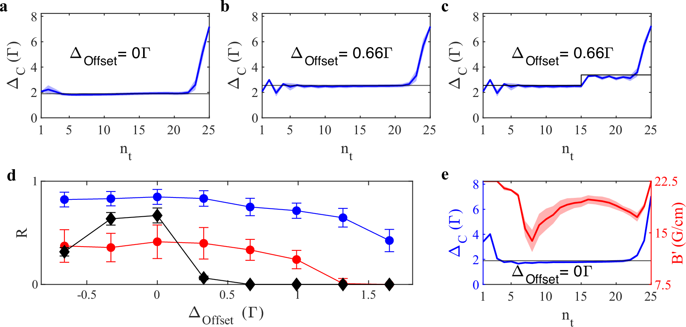
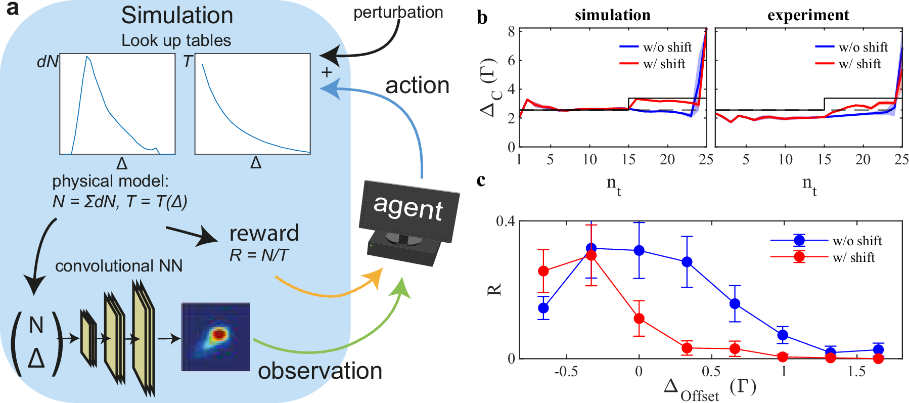
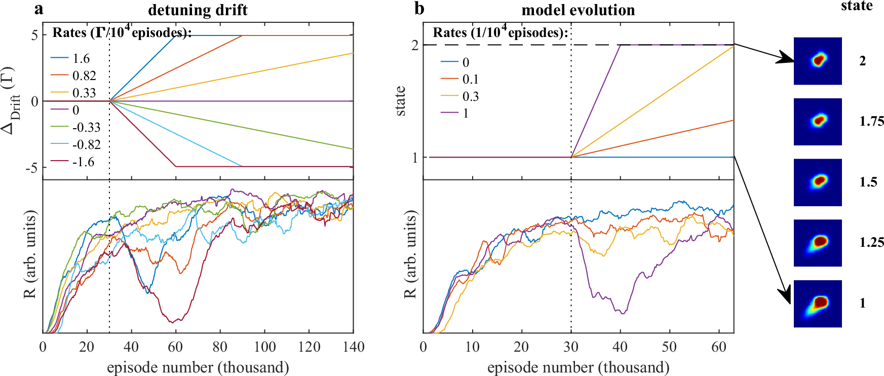

# Reinforcement learning in cold atom experiments

Nature Communications · 2024 · 方法借鉴

[论文原文](https://www.nature.com/articles/s41467-024-52775-8) · [DOI](https://doi.org/10.1038/s41467-024-52775-8)

观测、奖励采样时刻、扰动恢复和持续学习的紧凑范例。

许可：CC BY 4.0。分区详见 [筛选依据](../docs/selection.md)，未宣称已核验中科院一区。

## Fig. 1 决策步长与回报时机

**用途：** MDP 框架。

**画法借鉴：** 在闭环框架旁放时间轴，标出每步动作和 episode 末奖励。

**解释边界：** 稀疏终端奖励不能画成每步均可获取的测量。

[原始图页](https://www.nature.com/articles/s41467-024-52775-8/figures/1)

Reinschmidt, Malte; Fortágh, József; Günther, Andreas; Volchkov, Valentin V.. Reinforcement learning in cold atom experiments. Nature Communications (2024), Fig. 1. https://doi.org/10.1038/s41467-024-52775-8. CC BY 4.0. 未裁切、未重绘；按比例显示。

## Fig. 2 扰动下策略如何恢复

**用途：** 稳健性与风险。

**画法借鉴：** 把动作序列、扰动时刻和最终结果对应，区分偏置和突变扰动。

**解释边界：** 单次扰动恢复不能代表所有异常场景。

[原始图页](https://www.nature.com/articles/s41467-024-52775-8/figures/2)

Reinschmidt, Malte; Fortágh, József; Günther, Andreas; Volchkov, Valentin V.. Reinforcement learning in cold atom experiments. Nature Communications (2024), Fig. 2. https://doi.org/10.1038/s41467-024-52775-8. CC BY 4.0. 未裁切、未重绘；按比例显示。

## Fig. 4 仿真到真实的控制对照

**用途：** 泛化与迁移。

**画法借鉴：** 并列画仿真环境构建和两端控制响应，突出迁移接口。

**解释边界：** 相似轨迹不等于真实分布与仿真完全一致。

[原始图页](https://www.nature.com/articles/s41467-024-52775-8/figures/4)

Reinschmidt, Malte; Fortágh, József; Günther, Andreas; Volchkov, Valentin V.. Reinforcement learning in cold atom experiments. Nature Communications (2024), Fig. 4. https://doi.org/10.1038/s41467-024-52775-8. CC BY 4.0. 未裁切、未重绘；按比例显示。

## Fig. 5 环境漂移中的持续学习

**用途：** 稳健性与风险。

**画法借鉴：** 在一条时间轴上标注训练和部署分界，并显示环境变化和回报。

**解释边界：** 部署后仍在更新参数时，不应称为冻结策略评估。

[原始图页](https://www.nature.com/articles/s41467-024-52775-8/figures/5)

Reinschmidt, Malte; Fortágh, József; Günther, Andreas; Volchkov, Valentin V.. Reinforcement learning in cold atom experiments. Nature Communications (2024), Fig. 5. https://doi.org/10.1038/s41467-024-52775-8. CC BY 4.0. 未裁切、未重绘；按比例显示。
