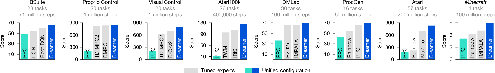
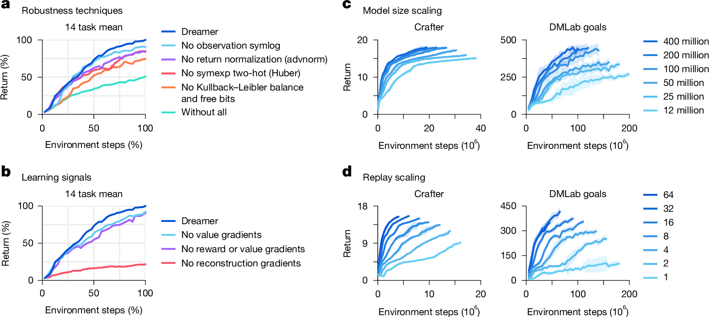

# Mastering diverse control tasks through world models

Nature · 2025 · 优先阅读

[论文原文](https://www.nature.com/articles/s41586-025-08744-2) · [DOI](https://doi.org/10.1038/s41586-025-08744-2)

适合讨论模型学习、想象轨迹、actor–critic 更新及跨任务鲁棒性。

许可：CC BY 4.0。分区详见 [筛选依据](../docs/selection.md)，未宣称已核验中科院一区。

## Fig. 1 真实经验与想象训练双循环

**用途：** 世界模型。

**画法借鉴：** 把经验编码、动态预测、想象 rollout 和策略更新分别画出。

**解释边界：** 想象轨迹不能标作真实环境测量。

[原始图页](https://www.nature.com/articles/s41586-025-08744-2/figures/1)

Hafner, Danijar; Pasukonis, Jurgis; Ba, Jimmy; Lillicrap, Timothy. Mastering diverse control tasks through world models. Nature (2025), Fig. 1. https://doi.org/10.1038/s41586-025-08744-2. CC BY 4.0. 未裁切、未重绘；按比例显示。

## Fig. 4 多任务多预算的基线比较

**用途：** 性能比较。

**画法借鉴：** 按任务与数据预算分组，使不同算法的训练成本可见。

**解释边界：** 不同基准的分数需注明归一化，不能直接求和。

[原始图页](https://www.nature.com/articles/s41586-025-08744-2/figures/4)

Hafner, Danijar; Pasukonis, Jurgis; Ba, Jimmy; Lillicrap, Timothy. Mastering diverse control tasks through world models. Nature (2025), Fig. 4. https://doi.org/10.1038/s41586-025-08744-2. CC BY 4.0. 未裁切、未重绘；按比例显示。

## Fig. 6 机制消融与模型规模效应

**用途：** 敏感性与消融。

**画法借鉴：** 把移除模块和增加模型规模分面展示，分开回答必要性与可扩展性。

**解释边界：** 架构消融必须控制计算预算与其他训练设置。

[原始图页](https://www.nature.com/articles/s41586-025-08744-2/figures/6)

Hafner, Danijar; Pasukonis, Jurgis; Ba, Jimmy; Lillicrap, Timothy. Mastering diverse control tasks through world models. Nature (2025), Fig. 6. https://doi.org/10.1038/s41586-025-08744-2. CC BY 4.0. 未裁切、未重绘；按比例显示。
