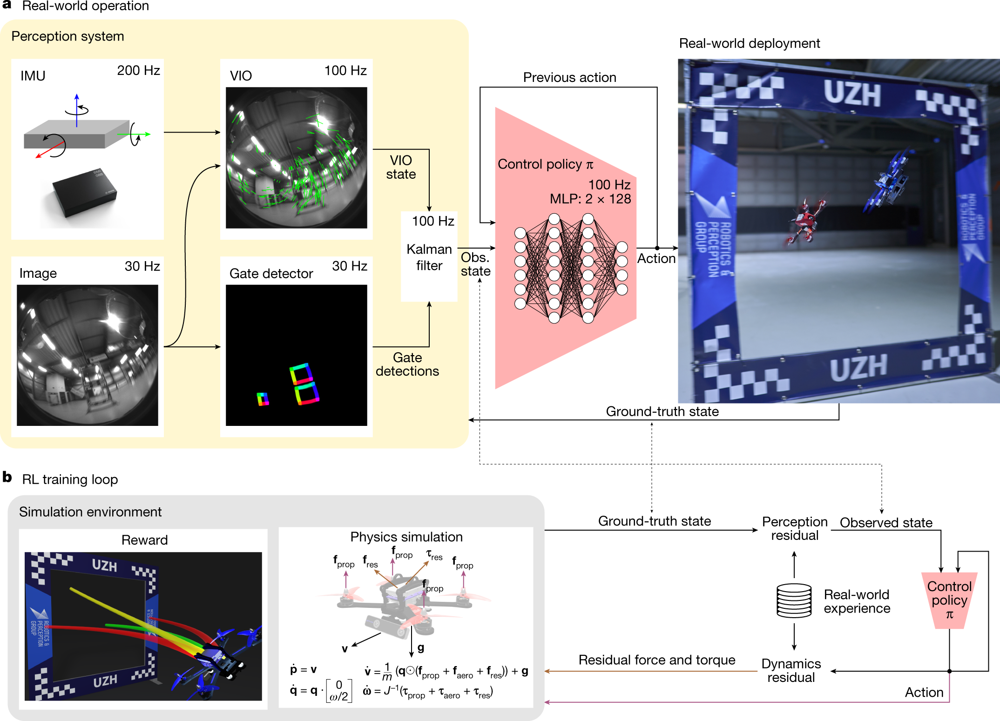
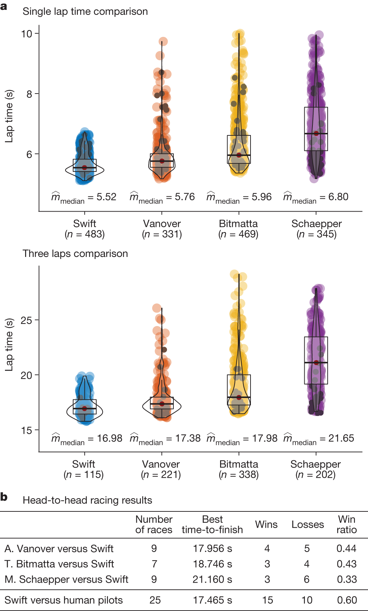
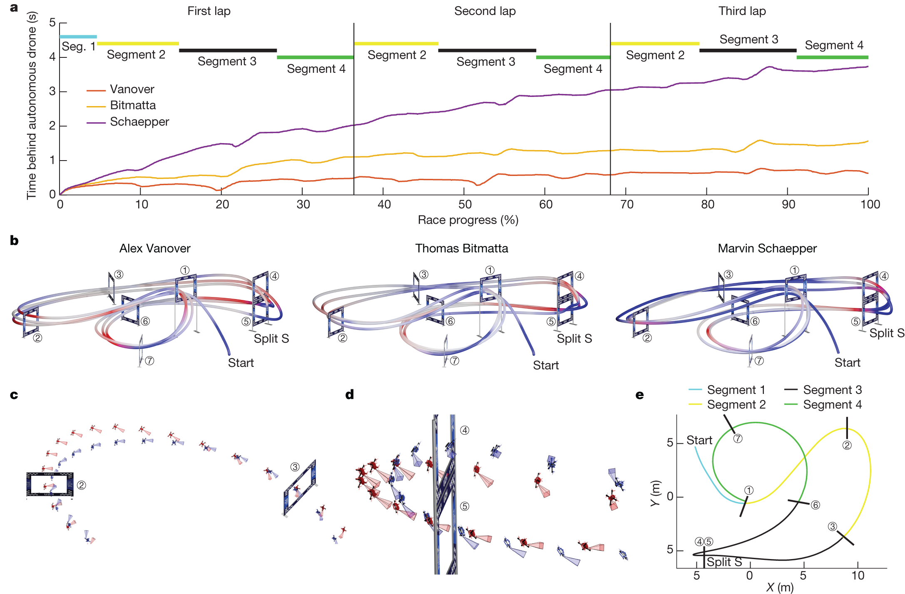

# Champion-level drone racing using deep reinforcement learning

Nature · 2023 · 方法借鉴

[论文原文](https://www.nature.com/articles/s41586-023-06419-4) · [DOI](https://doi.org/10.1038/s41586-023-06419-4)

适合训练与部署、感知到策略、轨迹和局部性能机制分析。

许可：CC BY 4.0。分区详见 [筛选依据](../docs/selection.md)，未宣称已核验中科院一区。

## Fig. 2 感知估计与策略部署

**用途：** 训练与部署。

**画法借鉴：** 从传感器到状态估计再到控制动作，旁边放仿真训练支路与真实数据校正。

**解释边界：** 感知误差和动力学误差应分别讨论。

[原始图页](https://www.nature.com/articles/s41586-023-06419-4/figures/2)

Kaufmann, Elia; Bauersfeld, Leonard; Loquercio, Antonio; Müller, Matthias; Koltun, Vladlen; Scaramuzza, Davide. Champion-level drone racing using deep reinforcement learning. Nature (2023), Fig. 2. https://doi.org/10.1038/s41586-023-06419-4. CC BY 4.0. 未裁切、未重绘；按比例显示。

## Fig. 3 基线成绩与成功稳定性

**用途：** 性能比较。

**画法借鉴：** 将结果分布和竞争结果并列，区分最快成绩与总体可靠表现。

**解释边界：** 单圈和连续多圈是不同统计单位。

[原始图页](https://www.nature.com/articles/s41586-023-06419-4/figures/3)

Kaufmann, Elia; Bauersfeld, Leonard; Loquercio, Antonio; Müller, Matthias; Koltun, Vladlen; Scaramuzza, Davide. Champion-level drone racing using deep reinforcement learning. Nature (2023), Fig. 3. https://doi.org/10.1038/s41586-023-06419-4. CC BY 4.0. 未裁切、未重绘；按比例显示。

## Fig. 4 策略为什么赢在这些位置

**用途：** 策略行为。

**画法借鉴：** 用沿路径的差值曲线定位优势区段，再用局部轨迹解释动作差异。

**解释边界：** 行为解释与干预验证的因果结论不同。

[原始图页](https://www.nature.com/articles/s41586-023-06419-4/figures/4)

Kaufmann, Elia; Bauersfeld, Leonard; Loquercio, Antonio; Müller, Matthias; Koltun, Vladlen; Scaramuzza, Davide. Champion-level drone racing using deep reinforcement learning. Nature (2023), Fig. 4. https://doi.org/10.1038/s41586-023-06419-4. CC BY 4.0. 未裁切、未重绘；按比例显示。
