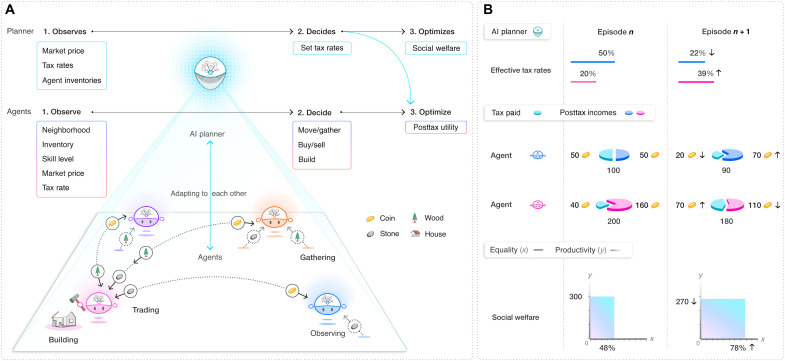
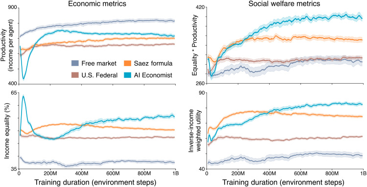
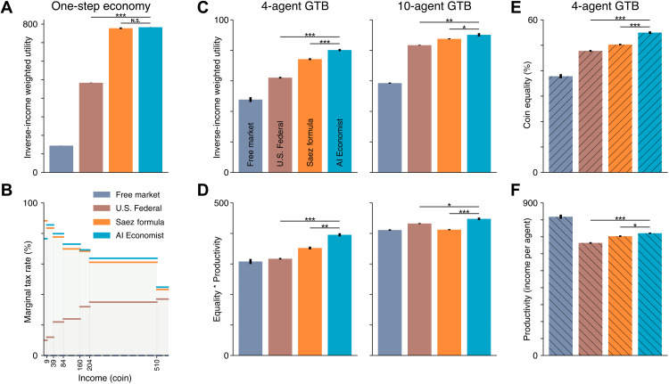
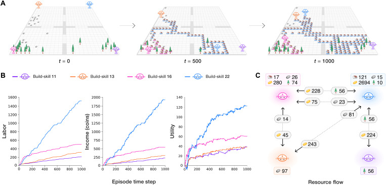
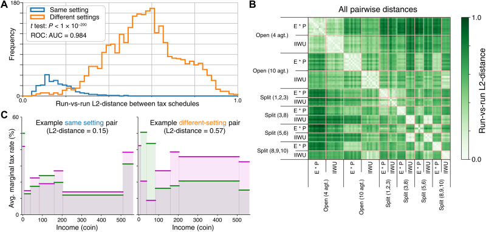
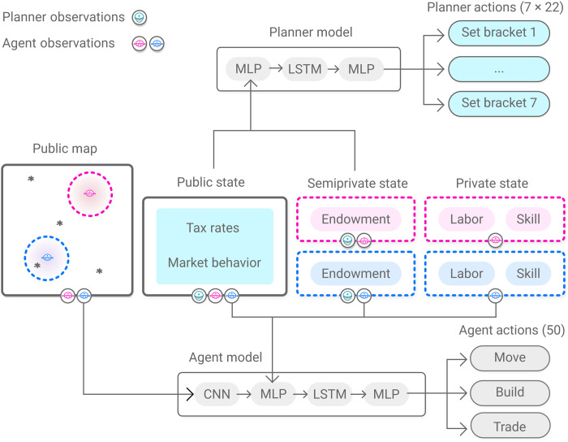

# The AI Economist: Taxation policy design via two-level deep multiagent reinforcement learning

Science Advances · 2022 · 优先阅读

[论文原文](https://pmc.ncbi.nlm.nih.gov/articles/PMC9067926/) · [DOI](https://doi.org/10.1126/sciadv.abk2607)

把规划者与个体分层，适合人地耦合、政策设计和多主体互动。

许可：CC BY 4.0。分区详见 [筛选依据](../docs/selection.md)，未宣称已核验中科院一区。

## Fig. 1 规划者与个体的双层学习

**用途：** 多智能体。

**画法借鉴：** 把慢尺度的制度动作与快尺度的个体动作分开；各层奖励分别标注。

**解释边界：** 规划者和个体并不共享同一个优化目标。

[原始图页](https://pmc.ncbi.nlm.nih.gov/articles/PMC9067926/figure/F1/)

Stephan Zheng; Alexander Trott; Sunil Srinivasa; David C Parkes; Richard Socher. The AI Economist: Taxation policy design via two-level deep multiagent reinforcement learning. Science Advances (2022), Fig. 1. https://doi.org/10.1126/sciadv.abk2607. CC BY 4.0. 未裁切、未重绘；按比例显示。

## Fig. 2 多主体训练的不稳定性

**用途：** 学习曲线。

**画法借鉴：** 展示规划者与个体的训练变化，并用重复训练的不确定性提示非平稳性。

**解释边界：** 跨随机种子的误差与 episode 内波动需要区别。

[原始图页](https://pmc.ncbi.nlm.nih.gov/articles/PMC9067926/figure/F2/)

Stephan Zheng; Alexander Trott; Sunil Srinivasa; David C Parkes; Richard Socher. The AI Economist: Taxation policy design via two-level deep multiagent reinforcement learning. Science Advances (2022), Fig. 2. https://doi.org/10.1126/sciadv.abk2607. CC BY 4.0. 未裁切、未重绘；按比例显示。

## Fig. 3 社会福利分解成可解释指标

**用途：** 多目标权衡。

**画法借鉴：** 把综合目标拆成公平和产出，并保留传统政策基线。

**解释边界：** 综合目标提高不能说明每个群体都受益。

[原始图页](https://pmc.ncbi.nlm.nih.gov/articles/PMC9067926/figure/F3/)

Stephan Zheng; Alexander Trott; Sunil Srinivasa; David C Parkes; Richard Socher. The AI Economist: Taxation policy design via two-level deep multiagent reinforcement learning. Science Advances (2022), Fig. 3. https://doi.org/10.1126/sciadv.abk2607. CC BY 4.0. 未裁切、未重绘；按比例显示。

## Fig. 4 时空行为与主体资源流

**用途：** 策略行为。

**画法借鉴：** 用环境快照、个体时间曲线和主体间流量图解释涌现分工。

**解释边界：** 流量图中的关联不自动意味着某主体对另一主体的因果影响。

[原始图页](https://pmc.ncbi.nlm.nih.gov/articles/PMC9067926/figure/F4/)

Stephan Zheng; Alexander Trott; Sunil Srinivasa; David C Parkes; Richard Socher. The AI Economist: Taxation policy design via two-level deep multiagent reinforcement learning. Science Advances (2022), Fig. 4. https://doi.org/10.1126/sciadv.abk2607. CC BY 4.0. 未裁切、未重绘；按比例显示。

## Fig. 7 政策差异的分布与矩阵

**用途：** 稳健性与风险。

**画法借鉴：** 比较同设置重复训练与跨设置的策略距离，量化学到的政策是否稳定。

**解释边界：** 距离度量与归一化方式会改变政策相似性。

[原始图页](https://pmc.ncbi.nlm.nih.gov/articles/PMC9067926/figure/F7/)

Stephan Zheng; Alexander Trott; Sunil Srinivasa; David C Parkes; Richard Socher. The AI Economist: Taxation policy design via two-level deep multiagent reinforcement learning. Science Advances (2022), Fig. 7. https://doi.org/10.1126/sciadv.abk2607. CC BY 4.0. 未裁切、未重绘；按比例显示。

## Fig. 9 不同主体各自看到什么

**用途：** 多智能体。

**画法借鉴：** 为个体和规划者分别列观测与动作接口，再连接各自策略网络。

**解释边界：** 仿真全局状态不能自动当作各主体在线观测。

[原始图页](https://pmc.ncbi.nlm.nih.gov/articles/PMC9067926/figure/F9/)

Stephan Zheng; Alexander Trott; Sunil Srinivasa; David C Parkes; Richard Socher. The AI Economist: Taxation policy design via two-level deep multiagent reinforcement learning. Science Advances (2022), Fig. 9. https://doi.org/10.1126/sciadv.abk2607. CC BY 4.0. 未裁切、未重绘；按比例显示。
