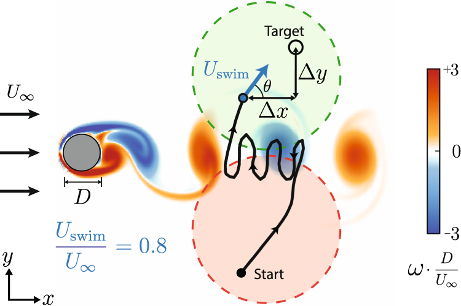
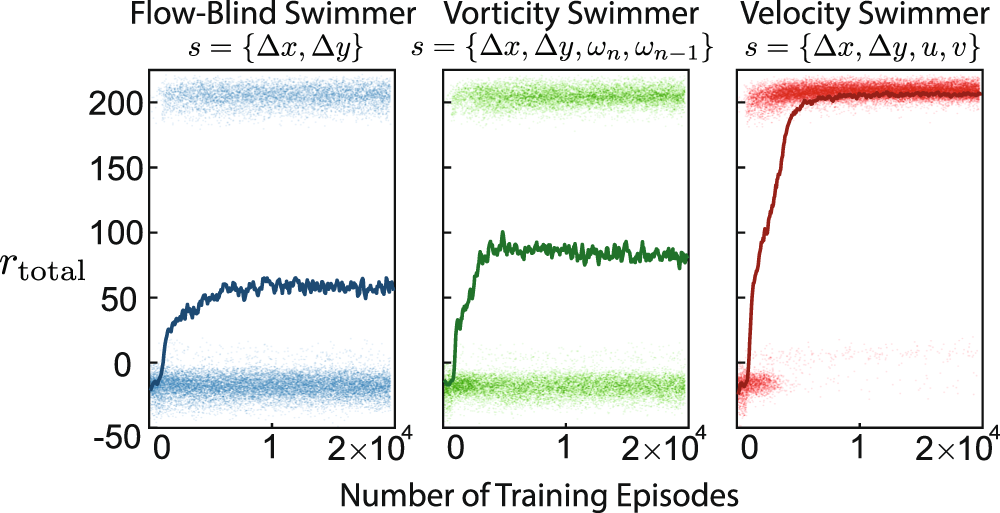
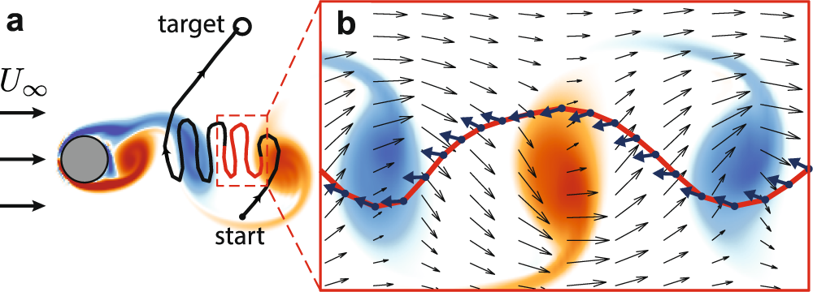
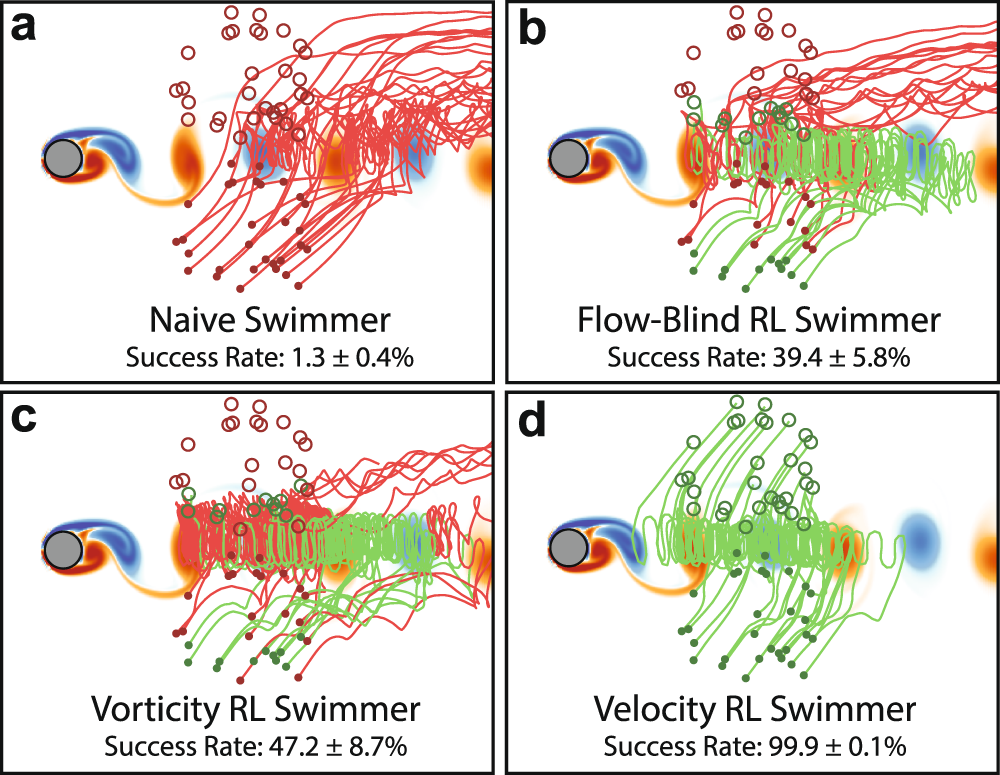
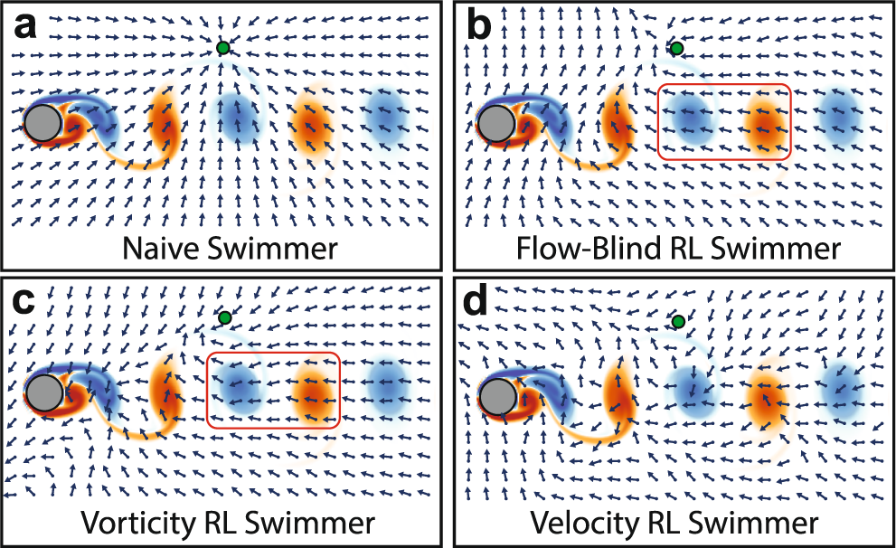
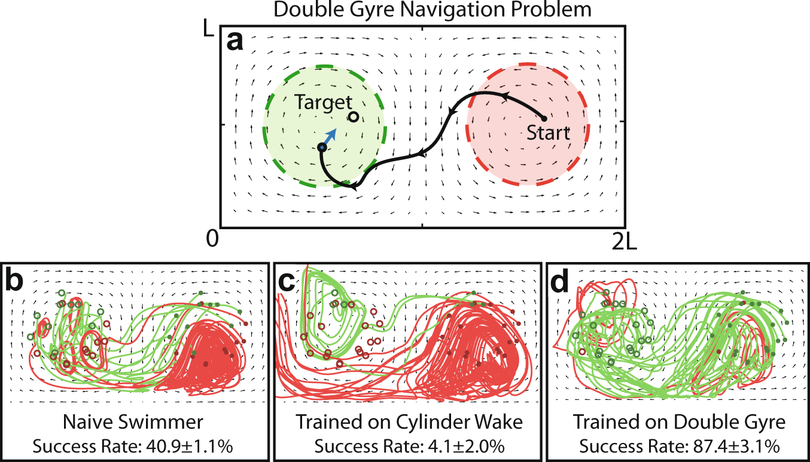

# Learning efficient navigation in vortical flow fields

Nature Communications · 2021 · 优先阅读

[论文原文](https://www.nature.com/articles/s41467-021-27015-y) · [DOI](https://doi.org/10.1038/s41467-021-27015-y)

空间轨迹、可观测性、策略场和跨环境失效的完整参考。

许可：CC BY 4.0。分区详见 [筛选依据](../docs/selection.md)，未宣称已核验中科院一区。

## Fig. 1 空间起点终点与决策任务

**用途：** MDP 框架。

**画法借鉴：** 在物理背景上标出起点分布、目标分布、流场和终止条件。

**解释边界：** 地图本身未说明状态、动作和奖励，需要另配定义。

[原始图页](https://www.nature.com/articles/s41467-021-27015-y/figures/1)

Gunnarson, Peter; Mandralis, Ioannis; Novati, Guido; Koumoutsakos, Petros; Dabiri, John O.. Learning efficient navigation in vortical flow fields. Nature Communications (2021), Fig. 1. https://doi.org/10.1038/s41467-021-27015-y. CC BY 4.0. 未裁切、未重绘；按比例显示。

## Fig. 2 训练回报与成功模式分离

**用途：** 学习曲线。

**画法借鉴：** 同时展示 episode 散点和趋势线，保留成功与失败回报的结构。

**解释边界：** 平滑窗口会影响视觉收敛速度，应显式报告。

[原始图页](https://www.nature.com/articles/s41467-021-27015-y/figures/2)

Gunnarson, Peter; Mandralis, Ioannis; Novati, Guido; Koumoutsakos, Petros; Dabiri, John O.. Learning efficient navigation in vortical flow fields. Nature Communications (2021), Fig. 2. https://doi.org/10.1038/s41467-021-27015-y. CC BY 4.0. 未裁切、未重绘；按比例显示。

## Fig. 3 轨迹与环境流场叠加

**用途：** 空间决策。

**画法借鉴：** 沿轨迹叠加方向，用局部参考系解释策略如何利用背景流。

**解释边界：** 环境速度与自主动作速度必须用不同图例。

[原始图页](https://www.nature.com/articles/s41467-021-27015-y/figures/3)

Gunnarson, Peter; Mandralis, Ioannis; Novati, Guido; Koumoutsakos, Petros; Dabiri, John O.. Learning efficient navigation in vortical flow fields. Nature Communications (2021), Fig. 3. https://doi.org/10.1038/s41467-021-27015-y. CC BY 4.0. 未裁切、未重绘；按比例显示。

## Fig. 4 成功失败轨迹成组比较

**用途：** 性能比较。

**画法借鉴：** 为各基线放同样数量的示例轨迹，另报全部评估的成功率。

**解释边界：** 展示的少量轨迹不等于统计样本量。

[原始图页](https://www.nature.com/articles/s41467-021-27015-y/figures/4)

Gunnarson, Peter; Mandralis, Ioannis; Novati, Guido; Koumoutsakos, Petros; Dabiri, John O.. Learning efficient navigation in vortical flow fields. Nature Communications (2021), Fig. 4. https://doi.org/10.1038/s41467-021-27015-y. CC BY 4.0. 未裁切、未重绘；按比例显示。

## Fig. 5 把状态到动作的映射画成场

**用途：** 策略行为。

**画法借鉴：** 在固定目标与时刻下展示动作方向场，比较不同观测信息的策略。

**解释边界：** 二维切片是条件策略，不能代表所有状态。

[原始图页](https://www.nature.com/articles/s41467-021-27015-y/figures/5)

Gunnarson, Peter; Mandralis, Ioannis; Novati, Guido; Koumoutsakos, Petros; Dabiri, John O.. Learning efficient navigation in vortical flow fields. Nature Communications (2021), Fig. 5. https://doi.org/10.1038/s41467-021-27015-y. CC BY 4.0. 未裁切、未重绘；按比例显示。

## Fig. 7 跨流场迁移也要展示失败

**用途：** 泛化与迁移。

**画法借鉴：** 明确列出源环境、直接迁移和再训练，比较成功率与轨迹。

**解释边界：** 再训练后的性能不能称为零样本泛化。

[原始图页](https://www.nature.com/articles/s41467-021-27015-y/figures/7)

Gunnarson, Peter; Mandralis, Ioannis; Novati, Guido; Koumoutsakos, Petros; Dabiri, John O.. Learning efficient navigation in vortical flow fields. Nature Communications (2021), Fig. 7. https://doi.org/10.1038/s41467-021-27015-y. CC BY 4.0. 未裁切、未重绘；按比例显示。
