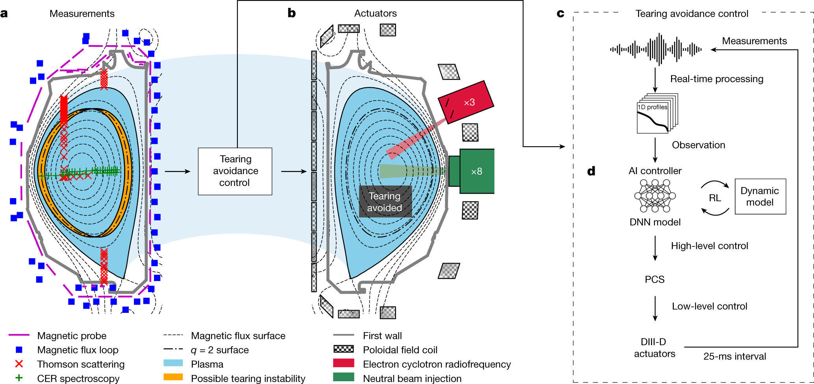
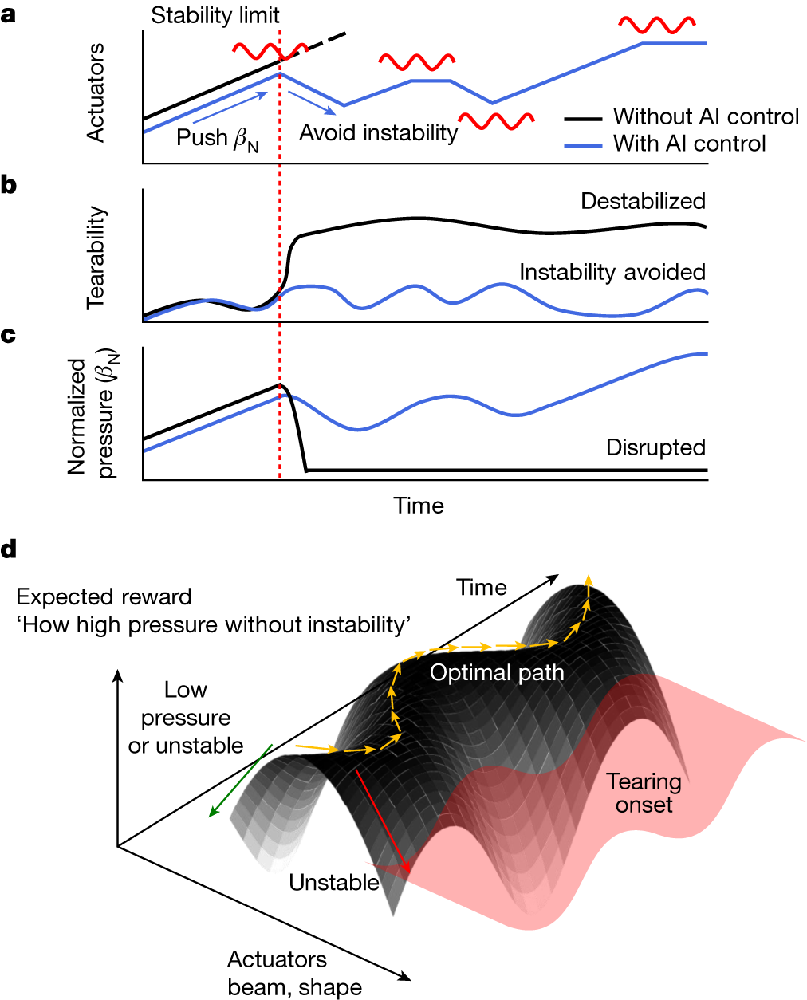
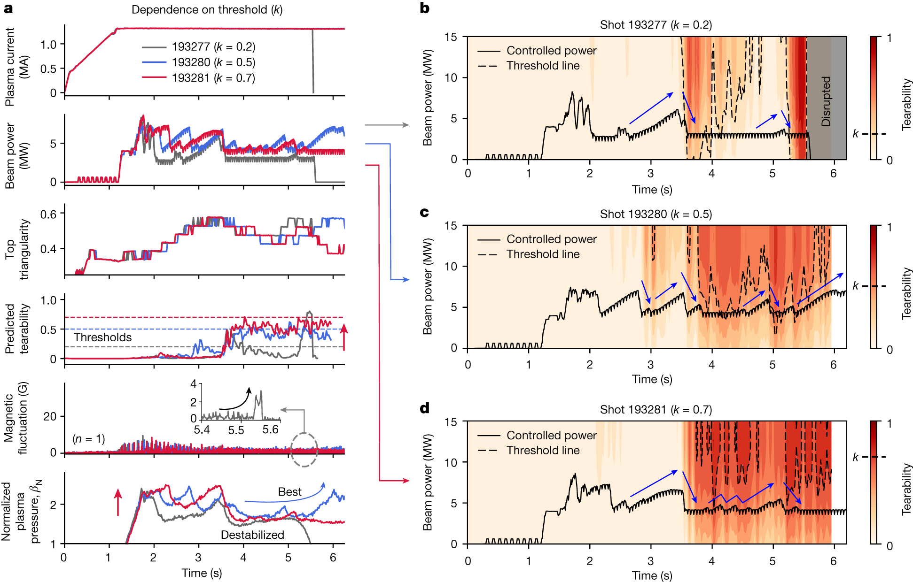

# Avoiding fusion plasma tearing instability with deep reinforcement learning

Nature · 2024 · 优先阅读

[论文原文](https://www.nature.com/articles/s41586-024-07024-9) · [DOI](https://doi.org/10.1038/s41586-024-07024-9)

适合借鉴风险预测、约束阈值与控制效果联合呈现。

许可：CC BY 4.0。分区详见 [筛选依据](../docs/selection.md)，未宣称已核验中科院一区。

## Fig. 1 风险预测接入控制链

**用途：** 安全与约束。

**画法借鉴：** 把感知预处理、风险估计、高层策略和底层执行分开，标清动作实际作用位置。

**解释边界：** 风险预测器的输出不等于经过证明的安全保证。

[原始图页](https://www.nature.com/articles/s41586-024-07024-9/figures/1)

Seo, Jaemin; Kim, SangKyeun; Jalalvand, Azarakhsh; Conlin, Rory; Rothstein, Andrew; Abbate, Joseph; Erickson, Keith; Wai, Josiah; Shousha, Ricardo; Kolemen, Egemen. Avoiding fusion plasma tearing instability with deep reinforcement learning. Nature (2024), Fig. 1. https://doi.org/10.1038/s41586-024-07024-9. CC BY 4.0. 未裁切、未重绘；按比例显示。

## Fig. 2 状态空间里的安全边界

**用途：** 安全与约束。

**画法借鉴：** 将轨迹放入风险与性能构成的相空间，标出风险等值线与限制区域。

**解释边界：** 预测边界的可靠程度取决于模型误差和分布覆盖。

[原始图页](https://www.nature.com/articles/s41586-024-07024-9/figures/2)

Seo, Jaemin; Kim, SangKyeun; Jalalvand, Azarakhsh; Conlin, Rory; Rothstein, Andrew; Abbate, Joseph; Erickson, Keith; Wai, Josiah; Shousha, Ricardo; Kolemen, Egemen. Avoiding fusion plasma tearing instability with deep reinforcement learning. Nature (2024), Fig. 2. https://doi.org/10.1038/s41586-024-07024-9. CC BY 4.0. 未裁切、未重绘；按比例显示。

## Fig. 4 风险阈值改变控制行为

**用途：** 敏感性与消融。

**画法借鉴：** 并列显示阈值设置、控制动作和风险响应，解释保守程度的代价。

**解释边界：** 少量单次实验的差异不能直接解释为显著性。

[原始图页](https://www.nature.com/articles/s41586-024-07024-9/figures/4)

Seo, Jaemin; Kim, SangKyeun; Jalalvand, Azarakhsh; Conlin, Rory; Rothstein, Andrew; Abbate, Joseph; Erickson, Keith; Wai, Josiah; Shousha, Ricardo; Kolemen, Egemen. Avoiding fusion plasma tearing instability with deep reinforcement learning. Nature (2024), Fig. 4. https://doi.org/10.1038/s41586-024-07024-9. CC BY 4.0. 未裁切、未重绘；按比例显示。
