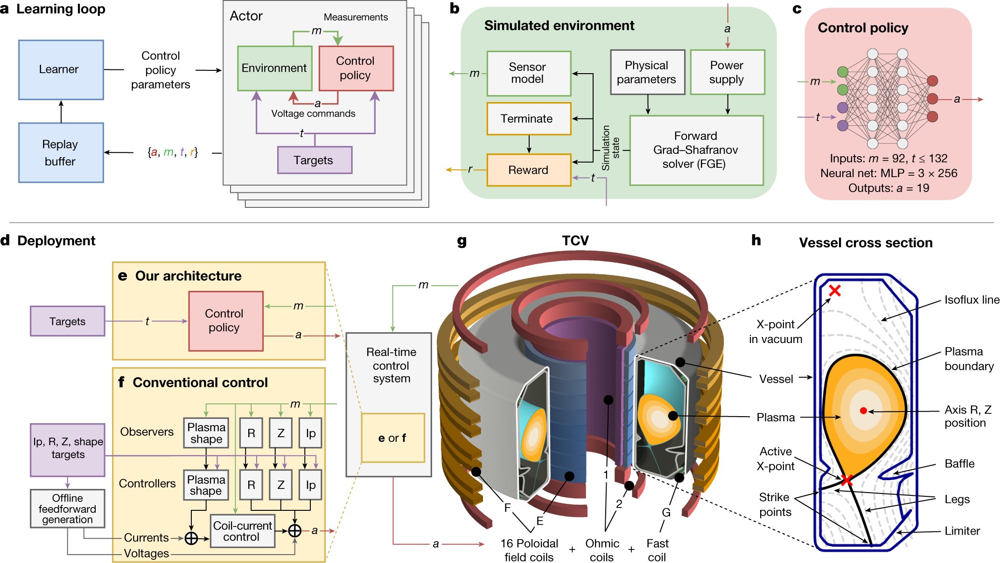
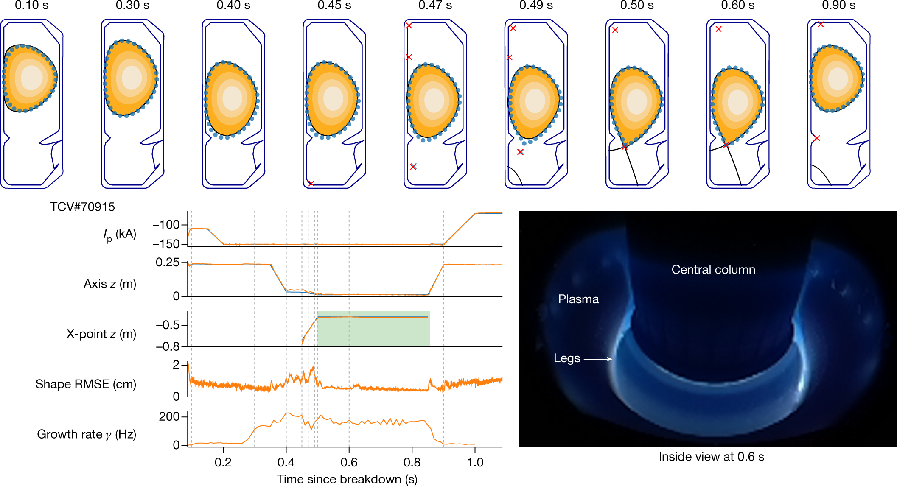
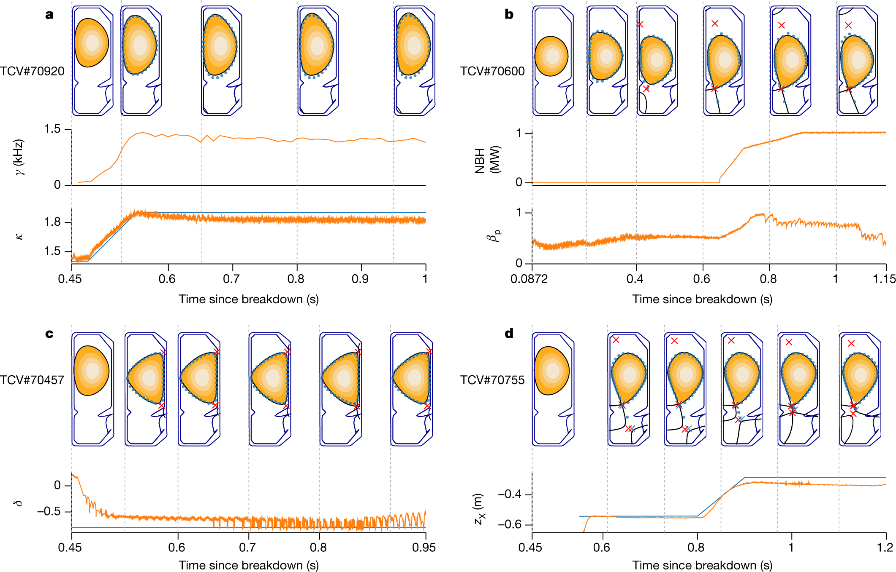

# Magnetic control of tokamak plasmas through deep reinforcement learning

Nature · 2022 · 优先阅读

[论文原文](https://www.nature.com/articles/s41586-021-04301-9) · [DOI](https://doi.org/10.1038/s41586-021-04301-9)

把目标定义、仿真训练、观测与动作、真实部署画在同一套系统中。

许可：CC BY 4.0。分区详见 [筛选依据](../docs/selection.md)，未宣称已核验中科院一区。

## Fig. 1 训练闭环与真实控制分开画

**用途：** 训练与部署。

**画法借鉴：** 分出 learner、经验缓冲、仿真器与在线控制器；用不同箭头表示学习更新和物理反馈。

**解释边界：** 训练可用的信息和在线可用的信息需要分别标注。

[原始图页](https://www.nature.com/articles/s41586-021-04301-9/figures/1)

Degrave, Jonas; Felici, Federico; Buchli, Jonas; Neunert, Michael; Tracey, Brendan; Carpanese, Francesco; Ewalds, Timo; Hafner, Roland; Abdolmaleki, Abbas; de las Casas, Diego; Donner, Craig; Fritz, Leslie; Galperti, Cristian; Huber, Andrea; Keeling, James; Tsimpoukelli, Maria; Kay, Jackie; Merle, Antoine; Moret, Jean-Marc; Noury, Seb; Pesamosca, Federico; Pfau, David; Sauter, Olivier; Sommariva, Cristian; Coda, Stefano; Duval, Basil; Fasoli, Ambrogio; Kohli, Pushmeet; Kavukcuoglu, Koray; Hassabis, Demis; Riedmiller, Martin. Magnetic control of tokamak plasmas through deep reinforcement learning. Nature (2022), Fig. 1. https://doi.org/10.1038/s41586-021-04301-9. CC BY 4.0. 未裁切、未重绘；按比例显示。

## Fig. 2 目标轨迹与实测响应对齐

**用途：** 策略行为。

**画法借鉴：** 把目标、控制响应和物理形态按时间对应，形成一条可核对的证据链。

**解释边界：** 跟踪效果需要同时报告误差和约束是否满足。

[原始图页](https://www.nature.com/articles/s41586-021-04301-9/figures/2)

Degrave, Jonas; Felici, Federico; Buchli, Jonas; Neunert, Michael; Tracey, Brendan; Carpanese, Francesco; Ewalds, Timo; Hafner, Roland; Abdolmaleki, Abbas; de las Casas, Diego; Donner, Craig; Fritz, Leslie; Galperti, Cristian; Huber, Andrea; Keeling, James; Tsimpoukelli, Maria; Kay, Jackie; Merle, Antoine; Moret, Jean-Marc; Noury, Seb; Pesamosca, Federico; Pfau, David; Sauter, Olivier; Sommariva, Cristian; Coda, Stefano; Duval, Basil; Fasoli, Ambrogio; Kohli, Pushmeet; Kavukcuoglu, Koray; Hassabis, Demis; Riedmiller, Martin. Magnetic control of tokamak plasmas through deep reinforcement learning. Nature (2022), Fig. 2. https://doi.org/10.1038/s41586-021-04301-9. CC BY 4.0. 未裁切、未重绘；按比例显示。

## Fig. 3 同一策略应对多种控制任务

**用途：** 泛化与迁移。

**画法借鉴：** 统一面板尺度，对齐多个目标配置，展示策略可覆盖的任务范围。

**解释边界：** 多种演示配置不能替代明确的训练测试划分。

[原始图页](https://www.nature.com/articles/s41586-021-04301-9/figures/3)

Degrave, Jonas; Felici, Federico; Buchli, Jonas; Neunert, Michael; Tracey, Brendan; Carpanese, Francesco; Ewalds, Timo; Hafner, Roland; Abdolmaleki, Abbas; de las Casas, Diego; Donner, Craig; Fritz, Leslie; Galperti, Cristian; Huber, Andrea; Keeling, James; Tsimpoukelli, Maria; Kay, Jackie; Merle, Antoine; Moret, Jean-Marc; Noury, Seb; Pesamosca, Federico; Pfau, David; Sauter, Olivier; Sommariva, Cristian; Coda, Stefano; Duval, Basil; Fasoli, Ambrogio; Kohli, Pushmeet; Kavukcuoglu, Koray; Hassabis, Demis; Riedmiller, Martin. Magnetic control of tokamak plasmas through deep reinforcement learning. Nature (2022), Fig. 3. https://doi.org/10.1038/s41586-021-04301-9. CC BY 4.0. 未裁切、未重绘；按比例显示。
